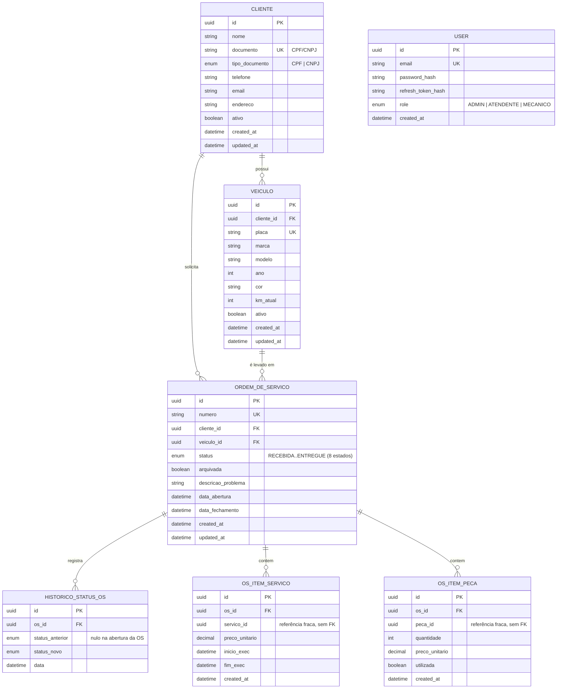

# Diagrama ER — Modelo Relacional

> Gerado a partir de `prisma/schema.prisma` (fonte da verdade). Este arquivo
> deve ser referenciado (ou copiado) em `oficina-infra-db` — o PDF exige
> "justificativa formal da escolha do banco + diagrama ER" nesse repo,
> já que é o dono do recurso de banco gerenciado (ver RFC 0002).

> **Escopo da Fase 2:** o modelo cobre só `clientes`, `veiculos`, `ordens_de_servico`
> (com itens) e `users`. Tabelas de catálogo (serviços, peças), estoque e
> orçamento saem deste diagrama e passam a viver nos serviços Billing/Execução.
> `os_itens_servico.servico_id` e `os_itens_peca.peca_id` são **referências
> fracas**: guardam o UUID informado, sem FK nem validação contra catálogo.

## Justificativa e relacionamentos

- **`clientes` 1:N `veiculos`**: um cliente pode ter vários veículos
  cadastrados; `veiculos.cliente_id` é obrigatório (todo veículo pertence a
  um cliente).
- **`clientes` 1:N `ordens_de_servico`** e **`veiculos` 1:N
  `ordens_de_servico`**: uma OS sempre referencia exatamente um cliente e
  um veículo (validado no `CreateOrdemDeServicoUseCase`: o veículo
  informado precisa pertencer ao cliente informado).
- **`ordens_de_servico` 1:N `os_itens_servico`**: cada item guarda o
  `servico_id` como referência fraca (sem FK, sem validação contra catálogo,
  já que o catálogo não existe nesta fase). O preço vem informado na
  requisição e é congelado em `preco_unitario`, e o intervalo de execução
  (`inicio_exec`/`fim_exec`) fica no próprio item.
- **`ordens_de_servico` 1:N `os_itens_peca`**: mesma lógica de referência
  fraca (`peca_id` sem FK) e preço congelado, mais a flag `utilizada`
  (peça reservada vs. efetivamente consumida na OS).
- **`ordens_de_servico` 1:N `historico_status_os`**: cada transição de
  status vira uma linha, com `status_anterior` nulo apenas no registro de
  abertura. Guardar a trilha em tabela própria (em vez de só o status atual
  na OS) é o que permite responder "quanto tempo a OS passou em cada
  status" — pergunta que o status corrente sozinho não responde. Alimenta o
  acompanhamento exposto ao cliente.
  Índice em `(os_id, data)` porque toda leitura é "a trilha desta OS, em
  ordem cronológica". `ON DELETE CASCADE`: a trilha não faz sentido sem a OS.
- **`users` isolada**: tabela de autenticação do staff (`ADMIN`/
  `ATENDENTE`/`MECANICO`), sem FK para o restante do modelo — é
  intencionalmente desacoplada do domínio de negócio (ver RFC 0003: `User`
  é auth interno por email/senha; `Cliente` passa a autenticar via CPF pela
  Lambda, mas `Cliente` já existia como entidade de negócio, não como
  registro de autenticação).

## Por que RDS PostgreSQL (não migra motor)

Ver RFC 0002 (`docs/rfc/0002-banco-de-dados-gerenciado.md`) para a análise
completa de alternativas. Resumo: o modelo acima já é 100% relacional com
FKs, enums e `@unique` constraints usados ativamente pelas regras de
negócio (ex.: `veiculos.placa` único, `clientes.documento` único) — trocar de
motor exigiria reescrever schema e migrations sem nenhum ganho para o escopo
do projeto. RDS PostgreSQL mantém o mesmo motor usado via Prisma desde a Fase 2.
