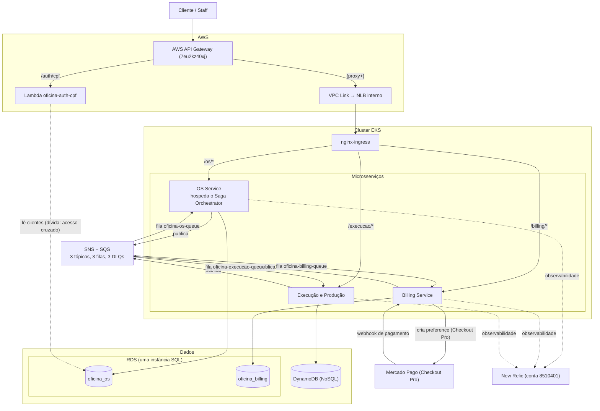

# Diagrama de Arquitetura — Microsserviços (Fase 4)

> Mostra a arquitetura final: entrada pelo API Gateway, roteamento por
> path no nginx-ingress do EKS, três microsserviços, cada um com o seu
> banco, barramento SNS + SQS, Mercado Pago e New Relic.

## Notas

- **Entrada**: o cliente e o staff chegam pelo API Gateway
  (id `7eu2kz40xj`). `/auth/cpf` vai para a Lambda
  `oficina-auth-cpf`; `{proxy+}` vai para o NLB interno, via VPC Link.
- **Roteamento**: o nginx-ingress no EKS roteia por path: `/os/*`,
  `/billing/*` e `/execucao/*`.
- **Saga**: o orquestrador da Saga roda dentro do OS Service. Não há
  serviço separado para ele.
- **Bancos**: cada serviço liga só ao próprio banco. `oficina_os` e
  `oficina_billing` são dois bancos lógicos na mesma instância RDS.
  Execução usa DynamoDB, que é NoSQL.
- **Eventos**: o barramento SNS + SQS tem 3 tópicos, 3 filas e 3 DLQs,
  ligado aos três serviços.
- **Pagamento**: o Billing Service cria a preference no Mercado Pago
  (Checkout Pro) e recebe o webhook de pagamento.
- **Dívida declarada**: a Lambda `oficina-auth-cpf` lê a tabela
  `clientes` direto em `oficina_os`, de que o OS Service é dono. É o
  único acesso cruzado restante (ver ADR 0008); a correção, consultar o
  OS Service por HTTP, fica fora desta fase.
- **Eventos (direção)**: cada serviço publica no barramento e consome da
  própria fila.
- **Observabilidade**: o New Relic (conta 8510401) observa os três
  serviços.
