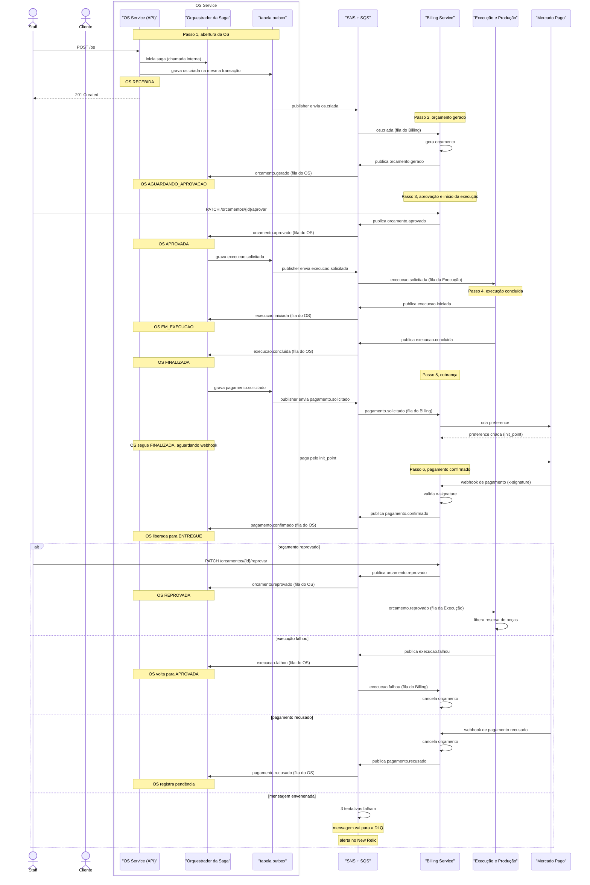

# Diagrama de Sequência — Saga da Ordem de Serviço

> Baseado na [RFC 0006](../rfc/0006-saga-pattern.md): Saga
> orquestrada, com o Orquestrador da Saga dentro do OS Service. Mostra
> o caminho feliz em 6 passos, as compensações e o ramo da DLQ.

## Notas

- Idempotência: cada consumidor (OS Service, Billing Service e
  Execução e Produção) mantém a tabela `mensagens_processadas` com o
  `messageId` único e descarta duplicatas. A entrega é at-least-once,
  então a duplicata é esperada.
- `correlationId` e `traceparent` vão nos message attributes, para o
  trace atravessar a fila SNS + SQS sem perder o contexto.
- O `outbox` garante que o evento é gravado na mesma transação do
  agregado. Um publisher periódico envia os registros pendentes ao SNS.
  Sem isso, haveria uma janela em que o agregado fica salvo e o evento
  se perde.
- `COMPENSADO` é status de `saga_passos`, não da OS. `REPROVADA` é
  status da OS. Não trocar os dois.
- Mensagem envenenada: após 3 tentativas falhas, a mensagem vai para a
  DLQ e dispara alerta no New Relic.
- Timeout de passo: o evento `saga.passo.expirado` não está no
  diagrama. Quando um passo estoura o prazo, o orquestrador o compensa e
  marca `saga_passos.status = COMPENSADO`; o status da OS não muda para
  `COMPENSADO`.
- O orquestrador mora dentro do OS Service: ele consome eventos de
  outros serviços pela fila do OS e grava o próximo comando na `outbox`,
  de onde o publisher envia ao SNS e à fila do serviço de destino.
  Nunca há volta pelo barramento para falar consigo mesmo.
- Aprovação e reprovação de orçamento batem no Billing Service, dono do
  módulo `orcamentos` na Fase 4.
- Detalhes e decisão de arquitetura: [RFC 0006](../rfc/0006-saga-pattern.md).
  Inspeção em tempo de execução: `GET /os/{id}/saga`, que devolve a
  instância da saga e seus passos.
